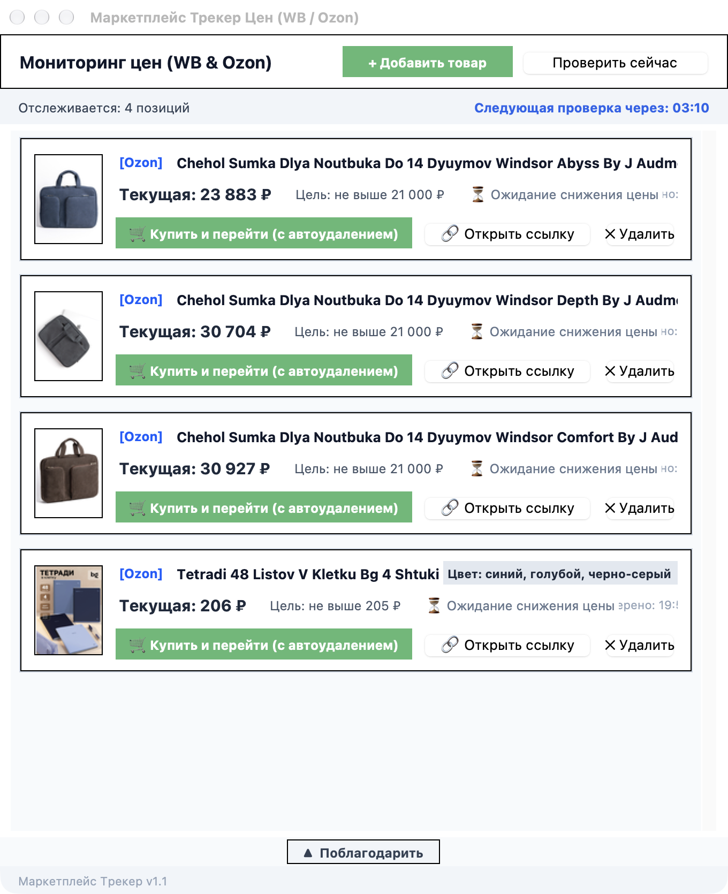
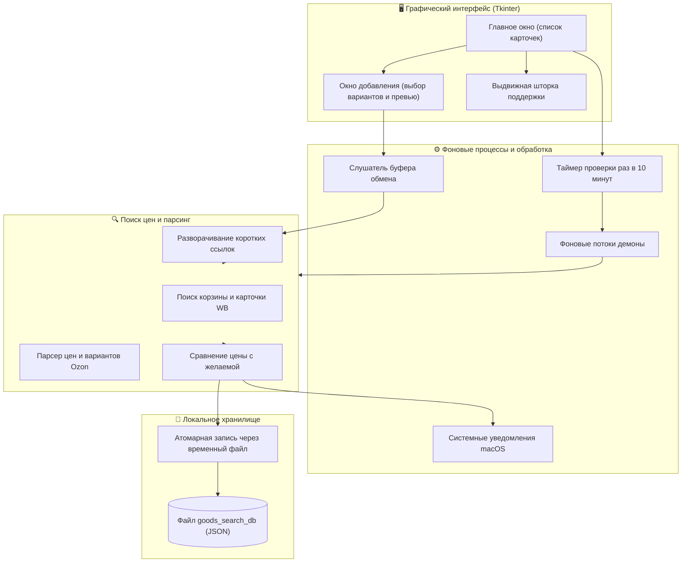

# 🛒 MarketTracker (Трекер цен WB & Ozon)

[](https://www.python.org/)
[](https://en.wikipedia.org/wiki/POSIX)
[](https://docs.python.org/3/library/tkinter.html)
[](https://docs.python.org/3/library/)
[](LICENSE)

> Небольшая и удобная десктопная программа, чтобы следить за ценами на товары с Wildberries и Ozon. Вставляешь ссылку, выбираешь нужный вариант (цвет или размер), указываешь желаемую цену покупки - и приложение каждые 10 минут само проверяет товар в фоне. Как только цена падает до нужной, приходит системное уведомление на компьютере.

---

## 📸 Внешний вид приложения



---

## 💡 Как это устроено и что умеет

- **Интерфейс не зависает:**  
  Все сетевые запросы, скачивание картинок и проверка цен вынесены в отдельные фоновые потоки (`threading.Thread`). Окно программы не фризится и всегда плавно отвечает на клики.
- **Понимает любые ссылки (включая короткие):**  
  Работают обычные ссылки из браузера, прямые артикулы, а также короткие ссылки из мобильных приложений (вроде `ozon.ru/t/...`, `wb.ru/...`, `linkwb.ru` и `wb.click`). Программа сама проходит по редиректам и находит настоящую карточку товара.
- **Выбор конкретного варианта:**  
  После проверки ссылки приложение подтягивает все доступные расцветки и размеры товара. Варианты аккуратно выстраиваются в столбик, можно выбрать нужный, посмотреть его фото в превью и сразу увидеть текущую цену.
- **Удобная авто-вставка из буфера обмена:**  
  Когда окно добавления товара открыто, не нужно даже нажимать вставку. Достаточно просто скопировать ссылку в браузере или приложении - программа сразу сама подхватит её из буфера и запустит проверку.
- **Надежное сохранение в файл:**  
  Список отслеживаемых товаров хранится в простом локальном файле `goods_search_db` рядом с программой. Сохранение идет через временный файл с атомарной заменой, поэтому база не повредится, даже если закрыть программу во время записи.
- **Минимум сторонних библиотек:**  
  Все написано на стандартной библиотеке Python (Tkinter, urllib, json, threading). Опционально используется только Pillow для красивого сжатия превьюшек (если Pillow нет, программа все равно работает).
- **Плавная шторка поддержки:**  
  Внизу главного окна есть аккуратная выдвижная панелька со стрелочкой, где можно поблагодарить автора или перейти по ссылкам.

---

## 🏗️ Архитектура системы



---

## 📦 Модель данных (JSON)

Каждый отслеживаемый товар сохраняется в локальной базе `goods_search_db` в таком формате:

```json
{
  "id": "wildberries_15000000_1740000000",
  "marketplace": "Wildberries",
  "url": "https://www.wildberries.ru/catalog/15000000/detail.aspx",
  "title": "Наименование товара",
  "variant": "Цвет / Модель: Черный",
  "image_url": "https://basket-01.wbbasket.ru/vol150/part150/15000000/images/c246x328/1.webp",
  "image_candidates": [
    "https://basket-01.wbbasket.ru/vol150/part150/15000000/images/c516x688/1.webp"
  ],
  "target_price": 2500,
  "current_price": 2350,
  "status": "Готово к покупке",
  "last_checked": "19:30:00",
  "notified": true
}
```

---

## 📊 Таблица асимптотики

| Операция | Как реализовано | Время (Time) | Память (Space) | Примечание |
| :--- | :--- | :---: | :---: | :--- |
| **Разворачивание коротких ссылок** | Проход по заголовкам `Location:` до 5 переходов | `O(H)` | `O(1)` | `H` - число редиректов (не больше 5). Защита от бесконечного цикла. |
| **Поиск сервера корзины WB** | Деление `nm // 100000` и подбор корзины | `O(1)` | `O(1)` | Мгновенно вычисляет адрес сервера с картинками и данными. |
| **Парсинг карточки Ozon** | Поиск JSON-блоков в HTML или открытой вкладке Safari | `O(L)` | `O(L)` | `L` - длина HTML-страницы. Находит блок с ценой и вариациями. |
| **Фоновая проверка всех товаров** | Поочередный опрос карточек товаров в потоке | `O(N)` | `O(N)` | `N` - количество товаров в списке. Интерфейс при этом не блокируется. |
| **Сохранение базы на диск** | Запись во временный файл и замена через `os.replace` | `O(N)` | `O(N)` | Гарантирует целостность базы данных при любых сбоях. |
| **Опрос буфера обмена** | Сравнение текста в буфере каждые 500 мс | `O(1)` | `O(1)` | Не нагружает процессор и не делает лишних запросов. |

---

## 🛠️ Сборка и запуск

### Что нужно для запуска
- **Python:** Версия `3.9` или новее.
- **ОС:** macOS, Linux или Windows.
- **По желанию:** Установить `Pillow` для качественных картинок превью (не обязательно, но с ним картинки выглядят четче):
  ```bash
  pip install pillow
  ```

### Как запустить

```bash
# Клонируем репозиторий
git clone git@github.com:git-sudo-ai/MarketTraker.git
cd MarketTraker

# Запускаем программу
python3 MarketTracker.py
```

Можно также сразу передать ссылку аргументом при запуске:
```bash
python3 MarketTracker.py "https://www.wildberries.ru/catalog/15000000/detail.aspx"
```

---

## 🎮 Управление в приложении

| Кнопка / Действие | Что делает |
| :--- | :--- |
| **`+ Добавить товар`** | Открывает окно для добавления новой ссылки. |
| **`Проверить сейчас`** | Сразу запускает проверку цен для всех товаров, не дожидаясь 10 минут. |
| **Скопировать ссылку (`Cmd+C` / `Ctrl+C`)** | Если окно добавления уже открыто, ссылка автоматически вставится и проверится. |
| **`🔗 Открыть ссылку`** | Открывает страницу товара в браузере в новой вкладке. |
| **`Купить и перейти`** | Появляется, когда цена упала до желаемой. Открывает товар и сразу удаляет его из базы, чтобы не захламлять список. |
| **`✕ Удалить`** | Удаляет товар из списка и сохраняет изменения в файл. |
| **`▲ / ▼ Поблагодарить`** | Плавно открывает или скрывает шторку с QR-кодом для благодарности. |

---

## 📄 Лицензия

Проект распространяется под свободной лицензией **GNU General Public License v2.0 (GPL-2.0)**. Полный текст лицензии находится в файле [LICENSE](LICENSE).

---

## 👨‍💻 Автор

- **GitHub:** [@git-sudo-ai](https://github.com/git-sudo-ai)
- **Репозиторий проекта:** [MarketTraker](https://github.com/git-sudo-ai/MarketTraker)
