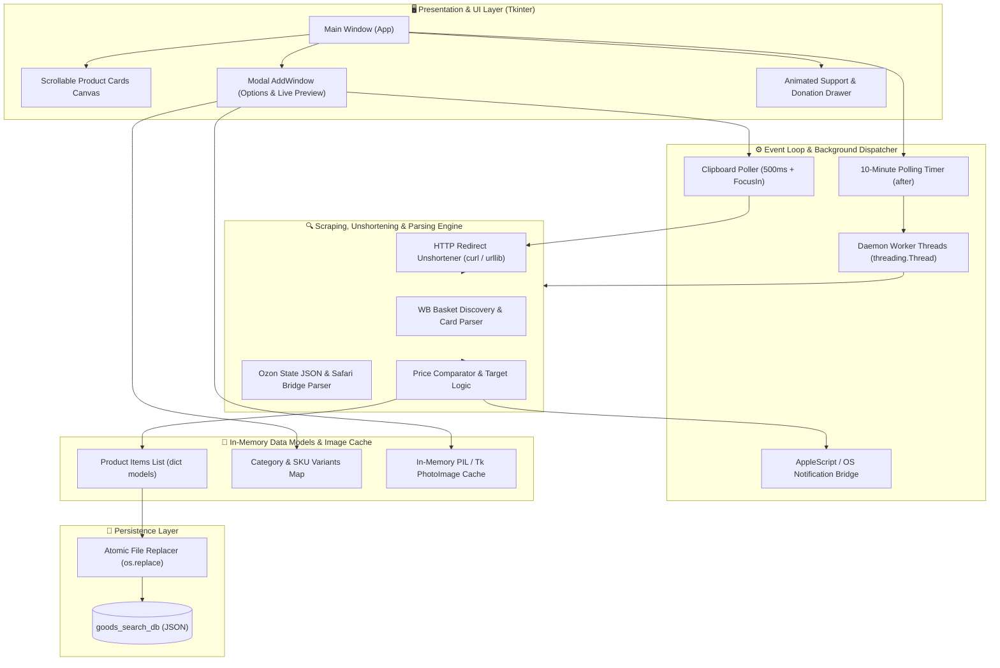

# 🛒 MarketTracker (WB & Ozon Price Monitor)

[](https://www.python.org/)
[](https://en.wikipedia.org/wiki/POSIX)
[](https://docs.python.org/3/library/tkinter.html)
[](https://docs.python.org/3/library/)
[](LICENSE)

> **Автономный кроссплатформенный десктопный монитор цен для маркетплейсов Wildberries и Ozon с фоновым асинхронным парсингом, разрешением коротких ссылок, многофакторным выбором вариантов и нативными оповещениями.**
> 
> Разработано по стандартам чистого системного программирования: нулевой оверхед по внешним библиотекам, полная изоляция сетевых вызовов в фоновых потоках без блокировки UI, нативный AppleScript-мост для чтения предрендеренного DOM в macOS и атомарная персистентность базы данных.

---

## ⚡ Ключевые инженерные решения

- **Архитектура с нулевыми тяжелыми зависимостями (Zero-Heavy-Dependency):**  
  Ядро построено исключительно на компонентах стандартной библиотеки Python (`tkinter`, `urllib`, `threading`, `json`, `subprocess`). Внешний модуль `Pillow` подключается опционально по схеме graceful degradation (при отсутствии PIL интерфейс продолжает функционировать в легковесном текстовом режиме).
- **Многопоточный асинхронный Event Loop:**  
  Все операции ввода-вывода (резолв DNS, HTTP-запросы, загрузка изображений, парсинг страниц) делегируются в потоки-демоны (`threading.Thread(daemon=True)`). Синхронизация с графическим контекстом Tkinter выполняется исключительно через потокобезопасный диспетчер `widget.after()`, что гарантирует отзывчивость интерфейса при 60 FPS без лагов.
- **Универсальный движок разворачивания коротких ссылок (Unshortener Engine):**  
  Поддержка мобильных диплинков и коротких доменов WB (`wb.ru`, `linkwb.ru`, `wb.click`) и Ozon (`ozon.ru/t/...`, `ozon.link/...`). Алгоритм отслеживает цепочки HTTP-редиректов (301, 302, 307, 308) с извлечением заголовка `Location:` через легковесные GET-запросы `curl` и перехватчик `NoRedirectHandler` в `urllib`, автоматически подставляя канонический URL в интерфейс.
- **Гибридный парсинг Wildberries и Ozon:**  
  - **Wildberries:** Прямой запрос к распределенным шардированным корзинам `basket-XX.wbbasket.ru` с динамическим вычислением номера сервера корзины по формуле `nm // 100000` и эвристическим поиском карточки товара `card.json`.
  - **Ozon:** Двухуровневый сбор данных. Для обхода Cloudflare/WAF антибот-челленджей на macOS реализован нативный AppleScript-мост (`osascript`), считывающий DOM из уже открытых вкладок Safari. При прямом запросе выполняется парсинг гидратированных JSON-состояний `state-webProductHeading` и `state-webPrice`.
- **Реактивный мониторинг буфера обмена (Live Clipboard Listener):**  
  В окне добавления товара работает непрерывный слушатель буфера (периодический опрос 500 мс + мгновенная реакция по событию `<FocusIn>`). При копировании ссылки в браузере или мессенджере приложение на лету подхватывает URL, вставляет его в поле ввода и запускает валидацию без необходимости закрывать и повторно открывать окно.
- **Атомарный слой персистентности (Atomic Persistence Layer):**  
  База данных отслеживаемых позиций сохраняется через запись во временный файл (`goods_search_db.tmp`) с последующей атомарной заменой через системный вызов `os.replace`. Это исключает повреждение JSON при внезапном сбое питания или принудительном завершении процесса.
- **Анимированный Support Drawer с плавной кинематикой:**  
  Интерактивная панель благодарности с плавной анимацией изменения высоты фрейма (`DRAWER_ANIM_STEP`), встроенным QR-кодом СБП и ссылками на социальные профили автора.

---

## 📸 Пошаговый сценарий работы

### 1. Мониторинг отслеживаемых товаров и статус цен
> **Инженерное решение:** Главное окно отображает карточки товаров с асинхронно кэшированными превью, индикатором дельты текущей и целевой цены, а также таймером обратного отсчета фонового цикла проверки (600 секунд). Позиции, достигшие целевой стоимости, визуально подсвечиваются зеленым бейджем «Готово к покупке».

---

### 2. Реактивное добавление товара и автодетекция буфера
> **Инженерное решение:** При копировании ссылки в любой программе модальное окно `AddWindow` мгновенно считывает системный буфер, нормализует протокол и домен, не требуя ручной вставки клавишами `Ctrl+V` / `Cmd+V`.

---

### 3. Разворачивание редиректов и категоризация вариантов
> **Инженерное решение:** Программа автоматически разворачивает короткие ссылки любого уровня вложенности (до 5 хопов), выгружает матрицу доступных вариаций (цвета, размеры, конфигурации) и выстраивает их в вертикальные столбцы по категориям с интерактивным выбором и пересчетом целевой цены со скидкой 5%.

---

### 4. Фоновый цикл и мгновенные системные нотификации
> **Инженерное решение:** Каждые 10 минут таймер запускает фоновую проверку пула товаров. Как только цена позиции падает ниже или на уровень заданной границы покупки, диспетчер отправляет системное push-уведомление через AppleScript `display notification` и воспроизводит аудиосигнал. При переходе к покупке товар автоматически удаляется из базы, предотвращая раздувание файла.

---

## 🏗️ Архитектура системы



---

## 📦 Модель данных (Data Model)

Внутреннее представление отслеживаемого объекта в базе данных `goods_search_db`:

```json
{
  "id": "wildberries_15000000_1740000000",
  "marketplace": "Wildberries",
  "url": "https://www.wildberries.ru/catalog/15000000/detail.aspx",
  "title": "Наименование товара",
  "variant": "Цвет / Модель: Черный",
  "image_url": "https://basket-01.wbbasket.ru/vol150/part150/15000000/images/c246x328/1.webp",
  "image_candidates": [
    "https://basket-01.wbbasket.ru/vol150/part150/15000000/images/c516x688/1.webp"
  ],
  "target_price": 2500,
  "current_price": 2350,
  "status": "Готово к покупке",
  "last_checked": "19:30:00",
  "notified": true
}
```

---

## 📊 Алгоритмическая спецификация

| Операция | Алгоритм / Реализация | Сложность (Time) | Сложность (Space) | Особенности |
| :--- | :--- | :---: | :---: | :--- |
| **Разворачивание коротких ссылок** | Итеративный переход по цепочке `Location:` (макс. 5 хопов) | `O(H)` | `O(1)` | Где `H` — число редиректов (H ≤ 5). Защита от бесконечных циклов перенаправления. |
| **Определение корзины WB** | Целочисленное деление `nm // 100000` + lookup корзин | `O(1)` | `O(1)` | Прямой расчет диапазона хостинга статических ассетов Wildberries. |
| **Парсинг DOM Ozon** | Регулярные выражения по гидрированным JSON-состояниям | `O(L)` | `O(L)` | Где `L` — размер HTML-документа. Извлечение `webPrice` и `webAspects`. |
| **Фоновый цикл проверки** | Пул параллельных проверок по списку товаров | `O(N)` | `O(N)` | Где `N` — число отслеживаемых товаров. Без блокировки UI. |
| **Атомарная персистентность** | Временный буфер + атомарный `os.replace` | `O(N)` | `O(N)` | Защита от повреждения JSON при сбоях ОС и аварийном завершении. |
| **Опрос буфера обмена** | Потактовая проверка изменения хэша содержимого (500 мс) | `O(1)` | `O(1)` | Исключение дублирующих парсингов при неизменном буфере. |

---

## 🛠️ Сборка и запуск

### Требования к окружению
- **Python:** Версия `3.9` или выше.
- **ОС:** macOS (поддержка нативных нотификаций и Safari AppleScript), Linux, Windows.
- **Опционально:** Библиотека `Pillow` для высококачественного масштабирования превью:
  ```bash
  pip install pillow
  ```

### Клонирование и запуск

```bash
# Клонирование репозитория
git clone git@github.com:git-sudo-ai/MarketTraker.git
cd MarketTraker

# Запуск приложения
python3 MarketTracker.py
```

Также поддерживается запуск с прямой передачей ссылки аргументом командной строки:
```bash
python3 MarketTracker.py "https://www.wildberries.ru/catalog/15000000/detail.aspx"
```

---

## 🎮 Управление в приложении

| Элемент / Действие | Назначение |
| :--- | :--- |
| **`+ Добавить товар`** | Открытие модального окна добавления и проверки ссылки. |
| **`Проверить сейчас`** | Принудительный внеочередной запуск проверки цен всех товаров в списке. |
| **Копирование ссылки (`Cmd+C` / `Ctrl+C`)** | Автоматическая подстановка скопированной ссылки в открытое окно добавления. |
| **`Купить и перейти`** | Открытие страницы товара в браузере с автоматическим удалением позиции из базы. |
| **`✕ Удалить`** | Удаление товара из отслеживания и очистка локальной базы данных. |
| **`▲ / ▼ Поблагодарить`** | Плавное открытие/скрытие шторки поддержки с QR-кодом СБП. |

---

## 📄 Лицензия

Проект распространяется под свободной лицензией **GNU General Public License v2.0 (GPL-2.0)**. Полный текст лицензии доступен в файле [LICENSE](LICENSE).

---

## 👨‍💻 Автор

- **GitHub:** [@git-sudo-ai](https://github.com/git-sudo-ai)
- **Проект:** [MarketTraker](https://github.com/git-sudo-ai/MarketTraker)
